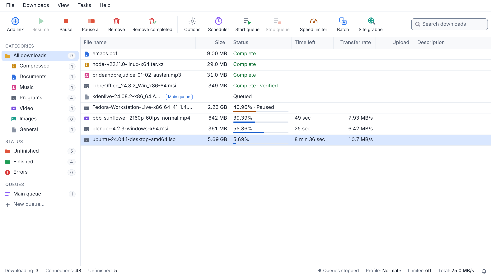
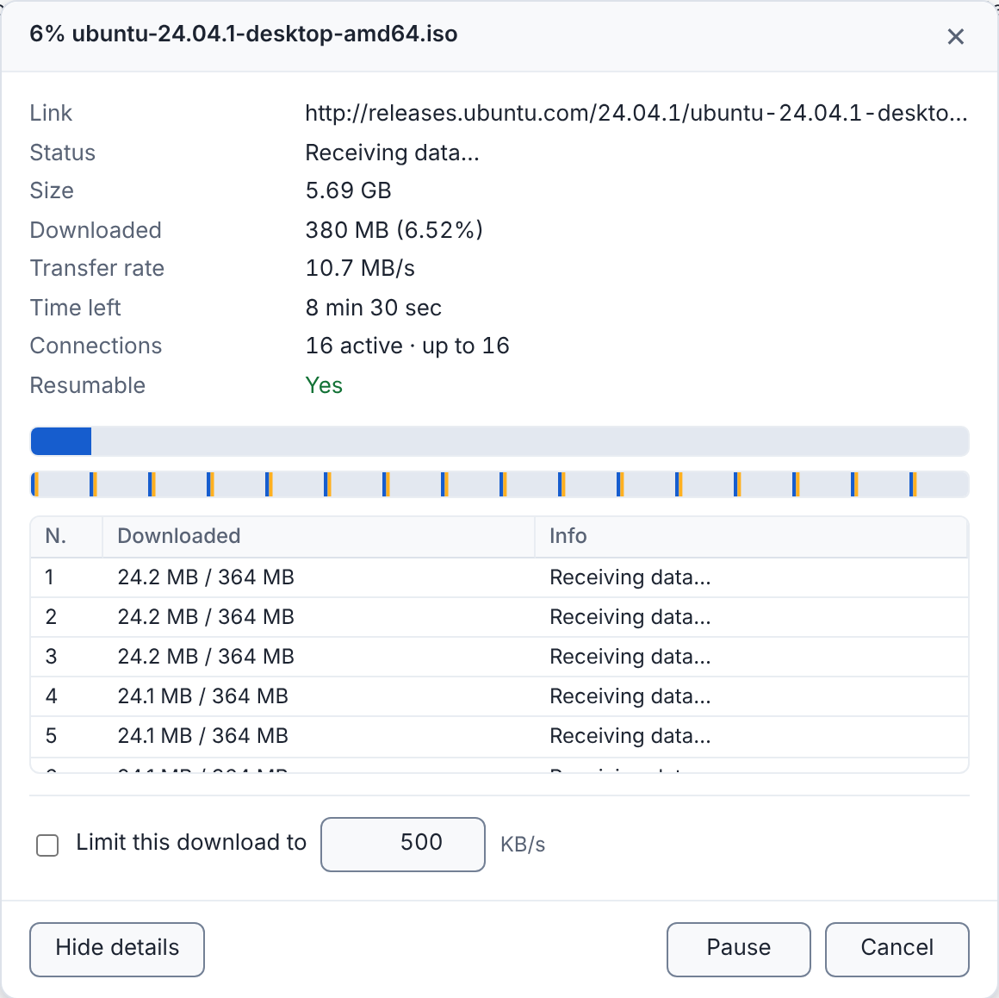

<div align="center">


# Zipline

**The download manager that gets the most out of your connection.**

Multi-connection downloads that pick up where they left off, plus torrents, video streams and cloud share links.<br>
One small app for Windows, macOS and Linux, with nothing else to install.

[](https://github.com/Oshan96/Zipline/releases/latest)
[](https://github.com/Oshan96/Zipline/actions/workflows/release.yml)
[](#download)
[](docs/development.md)

[**Download**](#download) · [**User guide**](docs/user-guide.md) · [**Browser extension**](docs/user-guide.md#browser-extension) · [**Build from source**](docs/development.md)

</div>

<p align="center">
  <picture>
    <source media="(prefers-color-scheme: dark)" srcset="assets/screenshots/window-dark.png">
    
  </picture>
</p>

## Why Zipline

<table>
<tr>
<td width="33%" valign="top">

### ⚡ Fast by design

Up to 32 connections per file, split and re-split on the fly, so one slow connection never holds up the finish. Several mirrors and several internet connections at once.

</td>
<td width="33%" valign="top">

### 🔁 Picks up where it stopped

Pause and resume across restarts and reboots. Outages, sleep and expired links don't cost you progress: Zipline gets a fresh link and carries on.

</td>
<td width="33%" valign="top">

### 🎬 Video, ready to play

HLS and DASH streams become one MP4 (or WebM, MKV) with no re-encoding, with your choice of quality, audio languages and subtitles. Live streams record too.

</td>
</tr>
<tr>
<td valign="top">

### 🧲 Torrents built in

Magnet links and `.torrent` files with the DHT, encryption, uTP, router port mapping, file priorities and streaming order.

</td>
<td valign="top">

### ☁️ Cloud share links

Google Drive, Dropbox, OneDrive, MEGA, Yandex Disk, pCloud, MediaFire and WeTransfer links download the file itself, shared folders included.

</td>
<td valign="top">

### 🧩 Works with your browser

The Chrome, Edge, Brave and Firefox extension sends links, videos and every link on a page to Zipline, with your sign-in, and can take over the browser's downloads.

</td>
</tr>
<tr>
<td valign="top">

### 🗓️ Queues and schedules

Queues with their own schedules and "when finished" actions, a scheduler that survives sleep, automatic retries, and sync queues that fetch what changed.

</td>
<td valign="top">

### 📊 Kind to your data plan

Traffic profiles, quotas that match real plans, free-hours downloads, an hourly cap, metered-connection pauses and a polite mode that makes way for video calls.

</td>
<td valign="top">

### 🔒 Private and careful

No accounts, ads or telemetry. Saved passwords are encrypted, checksums are verified, and files get the same "downloaded from the internet" mark as from a browser.

</td>
</tr>
</table>

**And more:** control from your phone on the same Wi-Fi, a site grabber, metalinks, FTP and FTPS, proxies and PAC scripts, an optional virus scan, a command line, full keyboard use and screen-reader support, and light and dark themes. The [user guide](docs/user-guide.md) covers all of it.

## Download

Get the newest version from the [releases page](https://github.com/Oshan96/Zipline/releases/latest):

| Platform | Installer | Portable |
|---|---|---|
| **Windows** 10 and 11 | [Zipline-Windows-Setup.exe](https://github.com/Oshan96/Zipline/releases/latest/download/Zipline-Windows-Setup.exe)<br><sub>x64 and Arm64, no administrator rights needed</sub> | [x64](https://github.com/Oshan96/Zipline/releases/latest/download/Zipline-Windows-x64.zip) · [Arm64](https://github.com/Oshan96/Zipline/releases/latest/download/Zipline-Windows-arm64.zip) |
| **macOS** 11 or later | [Zipline-macOS.dmg](https://github.com/Oshan96/Zipline/releases/latest/download/Zipline-macOS.dmg)<br><sub>Apple silicon and Intel</sub> | [Apple silicon](https://github.com/Oshan96/Zipline/releases/latest/download/Zipline-macOS-apple-silicon.zip) · [Intel](https://github.com/Oshan96/Zipline/releases/latest/download/Zipline-macOS-intel.zip) |
| **Linux** x64 | [Zipline-Linux-x64.deb](https://github.com/Oshan96/Zipline/releases/latest/download/Zipline-Linux-x64.deb)<br><sub>Debian, Ubuntu and their relatives</sub> | [tar.gz](https://github.com/Oshan96/Zipline/releases/latest/download/Zipline-Linux-x64.tar.gz) |

> [!NOTE]
> Zipline isn't code-signed yet, so Windows SmartScreen and macOS Gatekeeper ask before running it the first time. The user guide's [Install](docs/user-guide.md#install) section shows how to let it run.

## Quick start

1. **Install** Zipline and start it. Its window opens as an app window in Edge, Chrome or Brave.
2. **Add a download:** click **Add link**, paste a link with Ctrl+V, or drop one onto the window. Zipline reads the file's details and starts fetching while you choose where to save it.
3. **Add the browser extension** from the `extension` folder that comes with Zipline ([how](docs/user-guide.md#add-it-to-your-browser)). Then right-click any link → **Download with Zipline**, or switch on taking over the browser's downloads.

## How it gets its speed



- **Many connections, used well.** A download starts with up to 8 connections and doubles them while that makes it faster (16 by default, up to 32). When one finishes, it takes over half of the part with the most time left, so the end of a download never crawls.
- **No wasted round trips.** Connections and TLS sessions are reused, the first request already brings data, and parts are written straight into one file, so there's no merge step at the end.
- **Learns each server.** It settles on the number of connections a server accepts, respects "come back later", and spreads a download across mirrors by how fast each one is.
- **Shrugs off trouble.** Connections retry with backoff, wait out an offline computer without using up tries, and every download resumes after a crash or power cut from where its data really was.

<br clear="right">

## Documentation

| Document | What it covers |
|---|---|
| [User guide](docs/user-guide.md) | Installing, every feature, the browser extension, phone control, where data is kept, limitations and troubleshooting |
| [Security](docs/user-guide.md#security) | How the window, the extension, the phone page and saved passwords are protected |
| [Extension privacy](extension/PRIVACY.md) | What the browser extension reads, sends and keeps, and why |
| [Development](docs/development.md) | The repository's layout, building from source and running the tests |
| [Releasing](docs/releasing.md) | Versions, the release workflow, the packages and installers |

## Build from source

Zipline needs only Go 1.24 or newer: it uses the standard library alone, with no third-party modules and no cgo.

```sh
git clone https://github.com/Oshan96/Zipline.git
cd Zipline
go run ./cmd/zipline
```

[docs/development.md](docs/development.md) has cross-compiling, tests and packaging.

## Contributing

Bug reports, ideas and pull requests are welcome: see [CONTRIBUTING.md](CONTRIBUTING.md). Every merge to `main` is released automatically as a new version. For security problems, please follow the [security policy](SECURITY.md).
